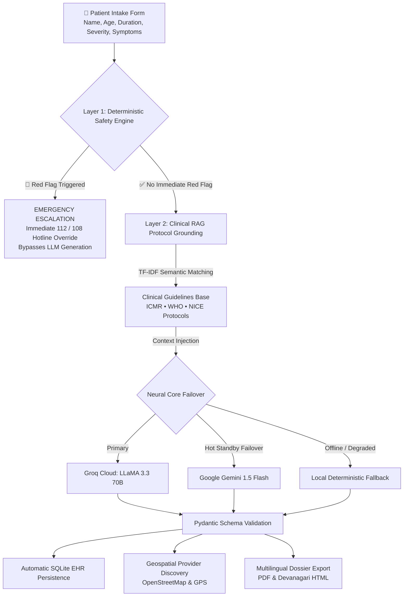

<div align="center">

# 🩺 MediGuide AI
### Intelligent Clinical Triage & Geospatial Care Navigation

*A safety-first clinical decision-support prototype bridging patient symptom articulation, guideline-grounded care navigation, and nearby healthcare discovery.*

<br/>

[](https://share.streamlit.io/)
[](https://www.python.org/)
[](LICENSE)
[](tests/)
[](src/ai_service.py)
[](https://www.openstreetmap.org/)
[](src/ui_components.py)

<br/>

[🌟 Overview](#-overview--clinical-rationale) • [🎮 Clinical Scenarios](#-interactive-clinical-scenarios) • [🛡️ Safety Architecture](#-dual-layer-safety-architecture) • [📱 Platform Modules](#-platform-modules--pages) • [⚡ Quick Start](#-quick-start) • [☁️ Deployment](#-streamlit-cloud-deployment) • [⚖️ Ethics](#-clinical-governance--disclaimer)

---

</div>

<br/>

## 🌟 Overview & Clinical Rationale

When individuals experience acute or unfamiliar symptoms, they frequently consult generic search engines. This often produces two dangerous extremes:
1. **Catastrophizing & Panic**: Minor benign symptoms are misinterpreted as severe life-threatening illnesses.
2. **Delayed Emergency Response**: Genuine acute crises (such as atypical acute myocardial infarction in older adults or neonatal fever in infants under 28 days) are downplayed, delaying urgent emergency room arrival.

**MediGuide AI** is an open-source clinical decision-support and care navigation platform designed to provide a safe, structured, and responsible alternative. It enforces a strict **Dual-Layer Architecture**:
- **Layer 1 (Independent Deterministic Safety Engine)**: Evaluates hard-coded clinical red flags *before* any language model invocation, prioritizing life-safety hotlines (112 / 108 in India).
- **Layer 2 (Guideline-Referenced Neural Core)**: Ingests clinical guideline excerpts (**ICMR**, **WHO**, **NICE**) via **Retrieval-Augmented Generation (RAG)** to provide structured, educational, doctor-ready consultation preparation reports.
- **Geospatial Care Discovery**: Connects patients with appropriate medical specialties and maps nearby healthcare facilities using live OpenStreetMap and device GPS data.

---

## 🎮 Interactive Clinical Scenarios

MediGuide AI includes 1-click clinical evaluation presets to demonstrate its dual-layer safety behavior:

```
┌─────────────────────────────────────────────────────────────────────────────────────────────────┐
│                                   CLINICAL TRIAGE PATHWAYS                                      │
├──────────────────────────────┬──────────────────────────────┬───────────────────────────────────┤
│ 🚨 SCENARIO 1: ACUTE CHEST   │ 👶 SCENARIO 2: INFANT FEVER  │ 👁️ SCENARIO 3: VISION BLUR       │
│    PRESSURE & SWEATING       │    (NEONATAL / PEDIATRIC)    │    & SEVERE OCULAR PAIN          │
├──────────────────────────────┼──────────────────────────────┼───────────────────────────────────┤
│ Patient: Rajesh Kumar (52y)  │ Patient: Baby Aarav (2 mo)   │ Patient: Ananya Verma (28y)       │
│ Input: "Crushing chest pain  │ Input: "Fever of 101F, weak  │ Input: "Severe right eye redness, │
│ radiating to left arm..."    │ cry, refusing to feed..."    │ blurred vision, light pain..."    │
├──────────────────────────────┼──────────────────────────────┼───────────────────────────────────┤
│ ⚡ Engine Behavior:           │ ⚡ Engine Behavior:           │ ⚡ Engine Behavior:                │
│ • Layer 1 Safety Triggered   │ • Pediatric Age Override     │ • Layer 1 Red Flags Cleared       │
│ • Deterministic Intercept    │ • Urgent Clinical Alert      │ • RAG Matches ICMR Guidelines     │
│ • Bypasses AI Generation     │ • Neonatal Protocol Active   │ • Specialty: Ophthalmology        │
├──────────────────────────────┼──────────────────────────────┼───────────────────────────────────┤
│ 📋 Output Action:            │ 📋 Output Action:            │ 📋 Output Action:                 │
│ 🚨 EMERGENCY: Dial 112 / 108 │ ⚠️ URGENT: Immediate doctor  │ 🩺 ROUTINE: Doctor-Ready Summary  │
│ Immediate ambulance dispatch │ evaluation within 2-4 hours  │ 📍 Maps nearby Eye Care Centers   │
└──────────────────────────────┴──────────────────────────────┴───────────────────────────────────┘
```

---

## 🛡️ Dual-Layer Safety Architecture

To prioritize patient safety and mitigate language model hallucinations, MediGuide AI decouples safety evaluation from text generation:



### 1. Layer 1: Deterministic Red-Flag Catalog
Executes in under **5 milliseconds** using clinical regex patterns grounded in NHS 111, Manchester Triage System, and WHO emergency guidelines:
- **Cardiovascular**: Crushing substernal chest pressure, radiation to left arm/jaw, diaphoresis.
- **Neurological**: Stroke FAST signs (facial drooping, unilateral arm weakness, slurred speech).
- **Respiratory**: Severe dyspnea, stridor, cyanosis, inability to complete sentences.
- **Pediatric & Neonatal**: Fever in neonates (`< 28 days`), lethargy, weak high-pitched cry, sunken fontanelle.
- **Obstetric**: Third-trimester bleeding, severe persistent epigastric pain with visual aura.

### 2. Layer 2: Evidence-Referenced RAG
- Pre-indexes official clinical practice guidelines from the **Indian Council of Medical Research (ICMR)**, **World Health Organization (WHO)**, and **UK NICE**.
- Retrieves relevant protocol excerpts based on symptom taxonomy.
- Injects guidelines into the model's system prompt context at a deterministic temperature (`0.2`).
- Discloses the exact retrieved clinical authority, title, and excerpt directly on the patient's assessment screen.

### 3. Layer 3: Multi-Provider Neural Failover
- **Primary Engine**: Groq Cloud (`llama-3.3-70b-versatile`) delivering rapid response times.
- **Hot-Standby Backup**: Google Gemini (`gemini-1.5-flash`) via direct REST endpoint with native JSON schema enforcement.
- **Zero Vendor Leaking**: Shielded under an enterprise brand abstraction (*"MediGuide Clinical Intelligence Engine"*).

---

## 📱 Platform Modules & Pages

MediGuide AI is structured into 5 dedicated healthcare portals:

### 1. 🩺 Intelligent Clinical Symptom Assistant (`1_Symptom_Assistant.py`)
- **Mandatory Intake Validation**: Requires Patient Full Name, Patient ID, Age, Gender, and detailed symptoms before running evaluation.
- **Age Stratification**: Evaluates numeric ages (0–115) into Neonate, Infant, Child, Adolescent, Adult, and Geriatric profiles.
- **Automatic EHR Persistence**: Assessments are automatically committed to the local SQLite database upon completion—no records are lost if the patient navigates away.
- **Multilingual Clinical Export**: Generates physician-ready consultation reports in **English**, **Hindi (हिन्दी)**, **Bengali (বাংলা)**, **Tamil (தமிழ்)**, **Telugu (తెలుగు)**, **Spanish (Español)**, and **French (Français)** in both PDF and printable HTML formats.

### 2. 📍 Geospatial Healthcare Provider Discovery (`2_Find_Doctors.py`)
- **Live HTML5 Hardware GPS**: Detects user device coordinates with fallback to city landmark search.
- **Clinical Triage Routing**: Automatically pre-filters recommended specialties when arriving directly from a symptom evaluation.
- **OpenStreetMap & Overpass Integration**: Live queries for public hospitals, specialized clinics, and pharmacies.
- **Strict Haversine Radius Enforcement**: Enforces an exact distance boundary (1–35 km) with direct Google Maps turn-by-turn directions.
- **Curated Regional Fallback**: Pre-indexed regional directories ensuring reliable results in Tier-2/3 Indian medical hubs (e.g. Muzaffarpur, Patna, Lucknow).

### 3. 📂 Patient Consultation History (`3_Session_History.py`)
- **Role-Based Separation**: Patients access only records linked to their specific Patient ID.
- **Audit Trails**: Clinical staff can review historical triage severity distribution and export master consultation logs as CSV.

### 4. 🗂️ Longitudinal Patient Health Portal (`4_Patient_Portal.py`)
- **EHR Record Lookup**: Patients track their longitudinal medical timeline across repeat assessments.
- **Consolidated Health Dossier**: Compiles all historical visits, symptom evolutions, and provider referrals into a single printable record.
- **Clinician Master Access**: Passkey-protected administrative mode for hospital physicians.

### 5. 🛡️ Clinical Safety & Governance Documentation (`5_About_and_Safety.py`)
- In-depth documentation of clinical boundaries, RAG architecture, ethics, and SaMD regulatory alignment.

---

## 💻 Tech Stack & Benchmarks

| Layer | Technology | Function | Performance Target |
| :--- | :--- | :--- | :--- |
| **Frontend UI** | Streamlit 1.35+ & Responsive CSS3 | Mobile-first responsive clinical interface | Zero horizontal overflow |
| **Safety Engine** | Deterministic Regex Rule Catalog | Emergency red-flag interceptor | `< 5 ms` execution |
| **Clinical RAG** | Scikit-learn TF-IDF Vectorizer | Protocol guideline retrieval (ICMR/WHO) | `< 25 ms` retrieval |
| **Primary LLM** | Groq Cloud (`llama-3.3-70b-versatile`) | Fast clinical symptom synthesis | Low-latency inference |
| **Backup LLM** | Google Gemini (`gemini-1.5-flash`) | Automated secondary neural failover | Seamless hot-standby |
| **Schema Validation**| Pydantic v2 | JSON contract enforcement | 100% schema validity |
| **Geospatial Engine**| OpenStreetMap Overpass & Nominatim | Healthcare facility queries | Real-time map discovery |
| **Distance Math** | Haversine Spherical Formula | Surface proximity calculations | Guaranteed `≤ radius` |
| **Persistence** | SQLite3 (Thread-Safe) | Longitudinal patient record storage | Parameterized SQL |
| **Document Engine** | ReportLab + Responsive HTML5 | Multilingual clinical summary export | Unicode Devanagari fidelity |

---

## ⚡ Quick Start

### Prerequisites
- Python 3.11+
- Free Groq Cloud API Key ([console.groq.com](https://console.groq.com/keys))
- *(Optional)* Free Google Gemini API Key ([aistudio.google.com](https://aistudio.google.com/app/apikey))

### 1. Clone & Set Up Environment
```bash
git clone https://github.com/Shariqueperwez/mediguide-ai.git
cd mediguide-ai

# Create virtual environment
python -m venv venv

# Activate virtual environment
# On Windows PowerShell:
.\venv\Scripts\Activate.ps1
# On macOS / Linux:
source venv/bin/activate

# Install dependencies
pip install -r requirements.txt
```

### 2. Configure API Secrets
Create a `.env` file in the project root:
```toml
# Primary Fast Inference Provider
GROQ_API_KEY="gsk_your_groq_api_key_here"

# Optional Hot-Standby Failover
GEMINI_API_KEY="AIzaSy_your_gemini_api_key_here"
```

### 3. Run the Application
```bash
streamlit run app.py
```
Open `http://localhost:8501` in your browser.

---

## 🧪 Automated Test Suite

MediGuide AI includes a test suite covering safety rules, RAG retrieval, geospatial math, and database operations.

```bash
python -m pytest tests -v
```

```
============================= test session starts =============================
collected 43 items

tests/test_auth.py ......................... PASSED                      [  9%]
tests/test_database.py ..................... PASSED                      [ 16%]
tests/test_provider_search.py .............. PASSED                      [ 32%]
tests/test_rag_engine.py ................... PASSED                      [ 41%]
tests/test_report_generator.py ............. PASSED                      [ 48%]
tests/test_safety_engine.py ................ PASSED                      [ 69%]
tests/test_specialty_recommender.py ........ PASSED                      [ 88%]
tests/test_symptom_parser.py ............... PASSED                      [100%]

============================= 43 passed in 38.33s =============================
```

---

## ☁️ Streamlit Cloud Deployment

Deploy live to **Streamlit Community Cloud** in 3 steps:

1. Push this repository to your GitHub account: `https://github.com/Shariqueperwez/mediguide-ai`
2. Go to [share.streamlit.io](https://share.streamlit.io/) and create a **New app**.
3. Select your repository, branch `main`, and main file path `app.py`.
4. In **Advanced settings &rarr; Secrets**, paste:
   ```toml
   GROQ_API_KEY = "gsk_your_groq_api_key_here"

   # Optional backup provider
   GEMINI_API_KEY = "AIzaSy_your_gemini_api_key_here"
   ```
5. Click **Deploy!**

---

## ⚖️ Clinical Governance & Disclaimer

> [!WARNING]
> **NOT A DIAGNOSTIC DEVICE**: MediGuide AI is designed strictly for health literacy, symptom articulation, and care navigation. It does not provide definitive medical diagnoses, interpret laboratory pathology, or prescribe pharmaceutical dosages.
>
> **EMERGENCY ASSISTANCE**: In any acute medical emergency, immediately dial **112 / 108** in India, **911** in the US, or **999** in the UK, or proceed to the nearest emergency department.
>
> **DATA PRIVACY**: MediGuide AI is architected under patient privacy principles aligned with DISHA and HIPAA guidelines. All evaluations are stored locally in the application's database.

---

<div align="center">
  <sub>Developed by <b>Sharique Perwez</b> • Distributed under the <a href="LICENSE">MIT License</a>.</sub>
</div>
