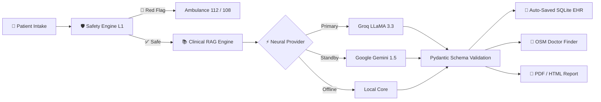

<div align="center">

# 🩺 MediGuide AI
### *Next-Generation Clinical Triage & Care Navigation Platform*

[](https://www.python.org/)
[](https://streamlit.io/)
[](https://groq.com/)
[](https://ai.google.dev/)
[](https://www.openstreetmap.org/)
[](LICENSE)

<br/>

<p align="center">
  <b>Sub-Second AI Clinical Triage</b> • <b>Deterministic Emergency Red-Flag Overrides</b> • <b>ICMR & WHO RAG Grounding</b> • <b>Live GPS Facility Discovery</b>
</p>

[✨ Key Features](#-key-features) • [🏗️ Architecture](#-system-architecture) • [⚡ Quick Start](#-quick-start) • [📊 Comparison](#-why-mediguide-ai) • [☁️ Deployment](#-cloud-deployment)

---

</div>

<br/>

## 💡 What is MediGuide AI?

> [!IMPORTANT]
> **MediGuide AI** is an enterprise-grade clinical decision-support and care navigation platform. It bridges the critical gap between confusing internet health searches and actual hospital care—helping patients articulate symptoms clearly, screening life-threatening red flags early, and routing them to the right medical specialist nearby.

```
                      ┌──────────────────────────────────────┐
                      │    Patient Describes Symptoms        │
                      └──────────────────┬───────────────────┘
                                         ▼
                      ┌──────────────────────────────────────┐
                      │ Layer 1: Deterministic Red-Flag Rule │
                      └──────────┬────────────────┬──────────┘
           Emergency Detected    │                │  Normal / Non-Acute
        ┌────────────────────────┘                └────────────────────────┐
        ▼                                                                  ▼
 🚨 112 / 108 Emergency Hotlines                          📚 Clinical RAG Protocol Grounding
 (Immediate Hospital Dispatch)                            (ICMR • WHO • NICE Protocols)
                                                                           │
                                                                           ▼
                                                          ⚡ Dual Neural Core (Groq + Gemini)
                                                                           │
                                                                           ▼
                                                          🏥 Live OpenStreetMap Doctor Finder
```

---

## ✨ Key Features

<table>
  <tr>
    <td width="50%">
      <h3>🛡️ Dual-Layer Safety Guardrails</h3>
      <ul>
        <li><b>Layer 1 (Independent Deterministic Core):</b> Screens acute emergencies (chest pain, stroke FAST, neonatal fever &lt;28 days, severe dyspnea) <i>before</i> AI inference.</li>
        <li><b>Layer 2 (Neural Clinical Guidance):</b> Synthesizes non-diagnostic consultation prep reports.</li>
      </ul>
    </td>
    <td width="50%">
      <h3>⚡ Multi-Provider Neural Failover</h3>
      <ul>
        <li><b>Primary:</b> Groq Cloud (<code>llama-3.3-70b-versatile</code>) for sub-second response times.</li>
        <li><b>Secondary (Hot Standby):</b> Google Gemini (<code>gemini-1.5-flash</code>) with automated seamless failover.</li>
        <li><b>Offline:</b> Deterministic local rules fallback.</li>
      </ul>
    </td>
  </tr>
  <tr>
    <td width="50%">
      <h3>📚 Evidence-Based RAG Grounding</h3>
      <ul>
        <li>Grounds all recommendations in published clinical practice guidelines from <b>ICMR</b>, <b>WHO</b>, and <b>NICE</b>.</li>
        <li>Displays explicit guideline authority citations on every patient assessment report.</li>
      </ul>
    </td>
    <td width="50%">
      <h3>📍 Live GPS Doctor & Clinic Finder</h3>
      <ul>
        <li>Direct OpenStreetMap Nominatim &amp; Overpass API integration.</li>
        <li>Strict specialty catalog matching (Cardiology, Eye, ENT, Pulmonology, Orthopedics, Pediatrics, Dentistry, Internal Med).</li>
        <li>Verified hospital search across metro &amp; Tier-2/3 cities (e.g. Muzaffarpur, Patna, Delhi, Bengaluru).</li>
      </ul>
    </td>
  </tr>
  <tr>
    <td width="50%">
      <h3>🗂️ Private Patient EHR &amp; RBAC</h3>
      <ul>
        <li>Mandatory patient intake validation (Full Name, Patient ID, Age, Gender, Blood Group).</li>
        <li><b>Auto-saves</b> every evaluation to local SQLite EHR records.</li>
        <li>Patients review history by ID; staff unlocks master registry via passkey.</li>
      </ul>
    </td>
    <td width="50%">
      <h3>📱 Mobile-First Responsive Design</h3>
      <ul>
        <li>Engineered for iPhones, Android smartphones, tablets, and widescreen desktops.</li>
        <li>Symmetrical 4&times;2 specialty capsule matrix automatically adapts to thumb-friendly single-column cards on phones.</li>
      </ul>
    </td>
  </tr>
</table>

---

## 📊 Why MediGuide AI?

| Capability | Generic Google Search | Typical Chatbot | 🩺 MediGuide AI |
| :--- | :---: | :---: | :---: |
| **Emergency Red-Flag Overrides** | ❌ No | ⚠️ Unreliable | ✅ **Deterministic Layer 1** |
| **Evidence-Based RAG Protocols** | ❌ No | ❌ Hallucinates | ✅ **ICMR • WHO • NICE Cited** |
| **Specialty Care Matching** | ❌ None | ⚠️ Generic Advice | ✅ **Exact Specialty Routing** |
| **Nearby Hospital Discovery** | ⚠️ Sponsored Ads | ❌ No Geo Support | ✅ **Live OpenStreetMap GPS** |
| **Multi-Provider Failover** | ❌ N/A | ❌ Single Point Failure | ✅ **Groq + Gemini Hot Standby** |
| **Doctor-Ready Reports** | ❌ No | ❌ Plain Text | ✅ **PDF & Devanagari/Hindi HTML**|

---

## 🏗️ System Architecture



---

## ⚡ Quick Start

<details open>
<summary><b>Local Installation (3 Steps)</b></summary>
<br/>

```bash
# 1. Clone repository
git clone https://github.com/Shariqueperwez/mediguide-ai.git
cd mediguide-ai

# 2. Setup virtual environment & install dependencies
python -m venv venv
.\venv\Scripts\Activate.ps1   # On Windows
pip install -r requirements.txt

# 3. Configure API Key & Run
# Copy .env.example to .env and insert your Groq or Gemini key:
streamlit run app.py
```
</details>

<details>
<summary><b>Running Automated Tests (43 Tests)</b></summary>
<br/>

```bash
python -m pytest tests -v
```
All **43 tests** pass cleanly across authentication, database persistence, geospatial routing, RAG retrieval, and deterministic safety rules.
</details>

---

## ☁️ Cloud Deployment

Deploy live to **Streamlit Community Cloud** in 2 minutes:

1. Fork or push this repository to your GitHub account: `https://github.com/Shariqueperwez/mediguide-ai`
2. Open [share.streamlit.io](https://share.streamlit.io/) and create a **New app**.
3. Under **Advanced settings &rarr; Secrets**, paste:
   ```toml
   # Primary inference provider (Free at console.groq.com)
   GROQ_API_KEY = "gsk_your_groq_api_key_here"

   # Optional hot-standby backup (Free at aistudio.google.com)
   GEMINI_API_KEY = "AIzaSy_your_gemini_api_key_here"
   ```
4. Click **Deploy!**

---

## ⚖️ Clinical Disclaimer

> [!WARNING]
> **MediGuide AI** is an educational and clinical care navigation platform. It does **not** provide definitive medical diagnoses or prescribe drug dosages. In case of an acute medical emergency, immediately dial **112 / 108** in India, **911** in the US, or **999** in the UK.

---

<div align="center">
  <sub>Built with ❤️ for accessible, evidence-grounded healthcare. Distributed under the MIT License.</sub>
</div>
