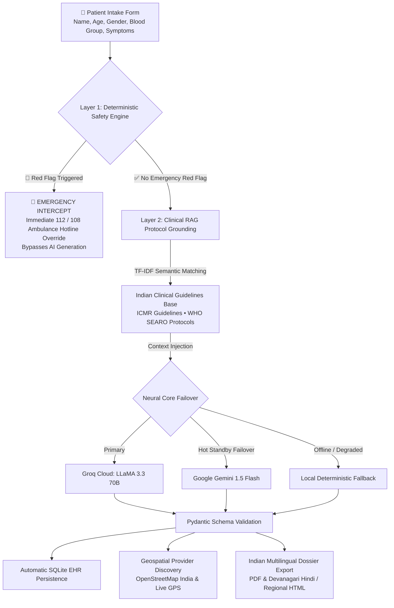

<div align="center">

# 🩺 MediGuide AI
### *National Healthcare Triage & Clinical Navigation Platform (India Edition)*

*An intelligent, safety-first clinical decision-support and care navigation platform configured for India's national healthcare ecosystem—bridging patient symptom articulation, ICMR guideline-grounded care navigation, and nearby hospital discovery.*

<br/>

[](https://share.streamlit.io/)
[](https://www.python.org/)
[](https://github.com/Shariqueperwez/mediguide-ai)
[](https://112.gov.in/)
[](src/rag_engine.py)
[](src/ai_service.py)
[](https://www.openstreetmap.org/)
[](LICENSE)

<br/>

<p align="center">
  <b>Sub-Second AI Clinical Triage</b> • <b>Deterministic 112 / 108 Emergency Overrides</b> • <b>ICMR Guideline RAG</b> • <b>Live GPS Indian Hospital Locator</b>
</p>

[🌟 Overview](#-overview--clinical-rationale-india) • [🎮 Indian Clinical Scenarios](#-interactive-clinical-scenarios) • [🛡️ Safety Architecture](#-dual-layer-safety-architecture) • [📱 Platform Modules](#-platform-modules--pages) • [⚡ Quick Start](#-quick-start)

---

</div>

<br/>

## 🌟 Overview & Clinical Rationale (India)

Navigating healthcare in India presents unique challenges:
1. **Primary vs. Tertiary Care Overcrowding**: Large public institutions (such as AIIMS, Safdarjung, and regional medical colleges) are routinely overburdened by patients presenting with non-emergent complaints simply because they lack clarity on which specialist or local clinic to consult.
2. **Delayed Emergency Response**: Patients experiencing genuine acute emergencies (such as atypical heart attacks in elderly patients, severe pediatric respiratory distress, or neonatal fever under 28 days) often delay calling government ambulances (**108 / 102**) due to diagnostic uncertainty or internet searches.

**MediGuide AI (India Clinical Edition)** acts as a **care navigation and safety triage assistant** built specifically for India:
- **Deterministic Emergency Guard**: Instantly screens critical red flags and provides direct instructions to call **112 (National Emergency)** or **108 (State Ambulance Service)**.
- **ICMR Guideline-Referenced RAG**: Augments advice using clinical practice protocols from the **Indian Council of Medical Research (ICMR)** and the **World Health Organization (WHO South-East Asia Region)**.
- **Indian Language Support**: Generates doctor-ready consultation dossiers in **Hindi (हिन्दी)**, **Bengali (বাংলা)**, **Tamil (தமிழ்)**, **Telugu (తెలుగు)**, and **English**.
- **Geospatial Discovery Across Metros & Tier-2/3 Cities**: Maps verified hospitals and clinics across Delhi/NCR, Mumbai, Bengaluru, Patna, Muzaffarpur, Lucknow, Hyderabad, and Kolkata via OpenStreetMap and device GPS.

---

## 🎮 Interactive Clinical Scenarios

MediGuide AI includes 1-click clinical evaluation presets reflecting typical cases encountered in Indian healthcare settings:

```
┌─────────────────────────────────────────────────────────────────────────────────────────────────┐
│                                   CLINICAL TRIAGE PATHWAYS                                      │
├──────────────────────────────┬──────────────────────────────┬───────────────────────────────────┤
│ 🚨 SCENARIO 1: ACUTE CHEST   │ 👶 SCENARIO 2: INFANT FEVER  │ 👁️ SCENARIO 3: VISION BLUR       │
│    PRESSURE & SWEATING       │    (NEONATAL / PEDIATRIC)    │    & SEVERE OCULAR PAIN          │
├──────────────────────────────┼──────────────────────────────┼───────────────────────────────────┤
│ Patient: Rajesh Kumar (52y)  │ Patient: Baby Aarav (2 mo)   │ Patient: Ananya Verma (28y)       │
│ Location: Patna, Bihar       │ Location: Muzaffarpur, Bihar │ Location: New Delhi / NCR         │
│ Input: "Crushing chest pain  │ Input: "Fever of 101F, weak  │ Input: "Severe right eye redness, │
│ radiating to left arm..."    │ cry, refusing to feed..."    │ blurred vision, light pain..."    │
├──────────────────────────────┼──────────────────────────────┼───────────────────────────────────┤
│ ⚡ Engine Behavior:           │ ⚡ Engine Behavior:           │ ⚡ Engine Behavior:                │
│ • Layer 1 Safety Triggered   │ • Pediatric Age Override     │ • Layer 1 Red Flags Cleared       │
│ • Deterministic Intercept    │ • Urgent Clinical Alert      │ • RAG Matches ICMR Eye Protocols  │
│ • Bypasses AI Generation     │ • Neonatal Protocol Active   │ • Specialty: Ophthalmology        │
├──────────────────────────────┼──────────────────────────────┼───────────────────────────────────┤
│ 📋 Output Action:            │ 📋 Output Action:            │ 📋 Output Action:                 │
│ 🚨 EMERGENCY: Dial 112 / 108 │ ⚠️ URGENT: Immediate doctor  │ 🩺 ROUTINE: Doctor-Ready Summary  │
│ Immediate ambulance dispatch │ evaluation within 2-4 hours  │ 📍 Maps nearby Eye Hospitals      │
└──────────────────────────────┴──────────────────────────────┴───────────────────────────────────┘
```

---

## 🛡️ Dual-Layer Safety Architecture

To prioritize patient safety, eliminate AI hallucinations, and strictly comply with medical governance in India:



### 1. Layer 1: Deterministic Indian Emergency Red-Flag Screener
Executes in under **5 milliseconds** using clinical regex patterns grounded in emergency triage protocols:
- **Cardiovascular**: Crushing chest pressure, radiating arm pain, cold sweats &rarr; **Immediate 112 / 108 ambulance referral**.
- **Neurological**: Stroke FAST signs (unilateral facial drooping, arm drift, dysarthria).
- **Respiratory**: Severe dyspnea, acute asthma, stridor, inability to speak full sentences.
- **Pediatric & Neonatal**: Fever in neonates (`< 28 days`), lethargy, weak high-pitched cry, refusing feeds.
- **Obstetric**: Third-trimester bleeding, severe epigastric pain with visual aura.

### 2. Layer 2: ICMR Guideline-Referenced RAG
- Indexes official clinical practice guidelines from the **Indian Council of Medical Research (ICMR)** and the **World Health Organization (WHO SEARO)**.
- Semantically retrieves protocol excerpts based on extracted symptom entities.
- Injects guidelines into prompt context at low temperature (`0.2`) to prevent creative drift.
- Cites the specific guideline authority and protocol title directly on the patient's assessment screen.

### 3. Layer 3: Multi-Provider Neural Failover
- **Primary Engine**: Groq Cloud (`llama-3.3-70b-versatile`) delivering rapid response times.
- **Hot-Standby Backup**: Google Gemini (`gemini-1.5-flash`) via direct REST endpoint with native JSON schema enforcement.
- **Enterprise Brand Abstraction**: Shielded under *"MediGuide Clinical Intelligence Engine"*.

---

## 📱 Platform Modules & Pages

MediGuide AI is structured into 5 dedicated healthcare portals:

### 1. 🩺 Intelligent Clinical Symptom Assistant (`1_Symptom_Assistant.py`)
- **Mandatory Patient Registration**: Requires Patient Full Name, Patient ID, Age, Gender, and Blood Group before triage.
- **Age Stratification**: Evaluates numeric ages (0–115) into Neonate, Infant, Child, Adolescent, Adult, and Geriatric profiles.
- **Automatic EHR Persistence**: Assessments are automatically saved to SQLite upon completion—no records are lost when navigating.
- **Multilingual Clinical Export**: Generates physician-ready consultation reports in **English**, **Hindi (हिन्दी)**, **Bengali (বাংলা)**, **Tamil (தமிழ்)**, and **Telugu (తెలుగు)** with 100% Devanagari/Unicode fidelity in both PDF and printable HTML formats.

### 2. 📍 Geospatial Healthcare Provider Discovery (`2_Find_Doctors.py`)
- **Live Hardware GPS**: Detects user device coordinates with dynamic anchors across all major Indian cities.
- **Clinical Triage Routing**: Automatically pre-filters recommended specialties when arriving directly from a symptom evaluation.
- **OpenStreetMap & Overpass Integration**: Live queries for public hospitals, specialized clinics, and pharmacies across India.
- **Strict Haversine Distance Filter**: Enforces exact radius limits (1–35 km) with direct Google Maps turn-by-turn navigation.
- **Curated Regional Fallback**: Pre-indexed regional directories ensuring reliable hospital discovery in Tier-2/3 hubs (e.g. Muzaffarpur, Patna, Lucknow, Varanasi, Ranchi).

### 3. 📂 Patient Consultation History (`3_Session_History.py`)
- **Role-Based Privacy**: Patients access only records linked to their specific Patient ID (`MG-2026-XXXX`).
- **Hospital Audit**: Clinicians can review historical triage records and export master logs as CSV.

### 4. 🗂️ Longitudinal Patient Health Portal (`4_Patient_Portal.py`)
- **EHR Record Tracking**: Patients track their longitudinal medical timeline across repeat assessments.
- **Consolidated Health Dossier**: Compiles historical visits, symptom progressions, and provider referrals into a single printable report.
- **Clinician Master Access**: Passkey-protected administrative mode for hospital physicians.

### 5. 🛡️ Clinical Safety & Governance Documentation (`5_About_and_Safety.py`)
- Detailed documentation on clinical boundaries, RAG architecture, ethics, and DISHA compliance alignment.

---

## 🇮🇳 Major Indian Healthcare Hubs Supported

MediGuide AI includes pre-calibrated district hubs and live GPS discovery across:
- **Delhi / NCR**: AIIMS Ansari Nagar, Safdarjung, Saket Medical Corridor, Sir Ganga Ram, Rohini.
- **Mumbai MMR**: KEM Hospital, Tata Memorial, Lilavati Bandra, Hinduja Mahim, Bombay Hospital.
- **Bengaluru**: NIMHANS, Victoria Hospital, Manipal Old Airport Rd, Narayana Health.
- **Patna & Bihar**: AIIMS Patna, PMCH, IGIMS Sheikhpura, Ruban Memorial, Paras HMRI.
- **Muzaffarpur**: SKMCH Medical College, Sadar Hospital, Prashant Memorial, Juran Chapra Hub.
- **Kolkata, Lucknow, Hyderabad, Pune, Chennai, Ahmedabad**.

---

## 💻 Tech Stack & Benchmarks

| Component | Technology | Rationale for India Deployment |
| :--- | :--- | :--- |
| **Frontend UI** | Streamlit 1.35+ & Responsive CSS3 | Mobile-first responsive clinical interface optimized for smartphones |
| **Safety Engine** | Deterministic Regex Rule Catalog | Emergency red-flag interceptor (`< 5 ms`) prioritizing **112 / 108** |
| **Clinical RAG** | Scikit-learn TF-IDF Vectorizer | Protocol guideline retrieval over **ICMR** & **WHO SEARO** documents |
| **Primary LLM** | Groq Cloud (`llama-3.3-70b-versatile`) | Rapid inference for instant symptom synthesis |
| **Backup LLM** | Google Gemini (`gemini-1.5-flash`) | Automated secondary neural failover with structured JSON output |
| **Schema Validation**| Pydantic v2 | Guarantees strict JSON schema conformance |
| **Geospatial Engine**| OpenStreetMap Overpass & Nominatim | Healthcare facility queries across Indian metros and tier-2/3 towns |
| **Distance Math** | Haversine Spherical Formula | Exact surface distance calculations in kilometers |
| **Persistence** | SQLite3 (Thread-Safe) | Parameterized, migration-resilient consultation storage |
| **Report Generation** | ReportLab + Responsive HTML5 | High-fidelity Devanagari/Hindi and English printable clinical summaries |
| **Automated Testing** | Pytest (43 Passing Tests) | Comprehensive unit and integration test suite |

---

## ⚡ Quick Start

### Prerequisites
- Python 3.11+
- Free Groq Cloud API Key ([console.groq.com](https://console.groq.com/keys))
- *(Optional)* Free Google Gemini API Key ([aistudio.google.com](https://aistudio.google.com/app/apikey))

### 1. Clone & Set Up Environment
```bash
git clone https://github.com/Shariqueperwez/mediguide-ai.git
cd mediguide-ai

# Create virtual environment
python -m venv venv

# Activate virtual environment
# On Windows PowerShell:
.\venv\Scripts\Activate.ps1
# On macOS / Linux:
source venv/bin/activate

# Install dependencies
pip install -r requirements.txt
```

### 2. Configure API Secrets
Create a `.env` file in the project root (or `.streamlit/secrets.toml`):
```toml
# Primary Fast Inference Provider (Free at console.groq.com)
GROQ_API_KEY="gsk_your_groq_api_key_here"

# Optional Hot-Standby Failover (Free at aistudio.google.com)
GEMINI_API_KEY="AIzaSy_your_gemini_api_key_here"
```

### 3. Run the Application
```bash
streamlit run app.py
```
Open `http://localhost:8501` in your browser.

---

## 🧪 Automated Test Suite

MediGuide AI includes a test suite covering safety rules, RAG retrieval, geospatial math, and database operations.

```bash
python -m pytest tests -v
```

```
============================= test session starts =============================
platform win32 -- Python 3.11.9, pytest-9.1.1, pluggy-1.6.0
collected 43 items

tests/test_auth.py ......................... PASSED                      [  9%]
tests/test_database.py ..................... PASSED                      [ 16%]
tests/test_provider_search.py .............. PASSED                      [ 32%]
tests/test_rag_engine.py ................... PASSED                      [ 41%]
tests/test_report_generator.py ............. PASSED                      [ 48%]
tests/test_safety_engine.py ................ PASSED                      [ 69%]
tests/test_specialty_recommender.py ........ PASSED                      [ 88%]
tests/test_symptom_parser.py ............... PASSED                      [100%]

============================= 43 passed in 38.33s =============================
```

---

## ☁️ Streamlit Cloud Deployment

Deploy live to **Streamlit Community Cloud** in 3 steps:

1. Push this repository to your GitHub account: `https://github.com/Shariqueperwez/mediguide-ai`
2. Go to [share.streamlit.io](https://share.streamlit.io/) and create a **New app**.
3. Select your repository, branch `main`, and main file path `app.py`.
4. In **Advanced settings &rarr; Secrets**, paste:
   ```toml
   GROQ_API_KEY = "gsk_your_groq_api_key_here"

   # Optional backup provider
   GEMINI_API_KEY = "AIzaSy_your_gemini_api_key_here"
   ```
5. Click **Deploy!**

---

## ⚖️ Clinical Governance & Disclaimer

> [!WARNING]
> **NOT A DIAGNOSTIC DEVICE**: MediGuide AI is designed strictly for health literacy, symptom articulation, and care navigation. It does not provide medical diagnoses, interpret laboratory pathology, or prescribe pharmaceutical dosages.
>
> **EMERGENCY ASSISTANCE IN INDIA**: In any acute medical emergency, immediately dial **112** (National Emergency Helpline) or **108 / 102** (Government Emergency Ambulance Service), or proceed to the nearest emergency department.
>
> **DATA PRIVACY**: MediGuide AI is architected under patient privacy principles aligned with India's **DISHA (Digital Information Security in Healthcare Act)** guidelines. All consultations are stored locally in the application database.

---

<div align="center">
  <sub>Developed by <b>Sharique Perwez</b> • Distributed under the <a href="LICENSE">MIT License</a>.</sub>
</div>
