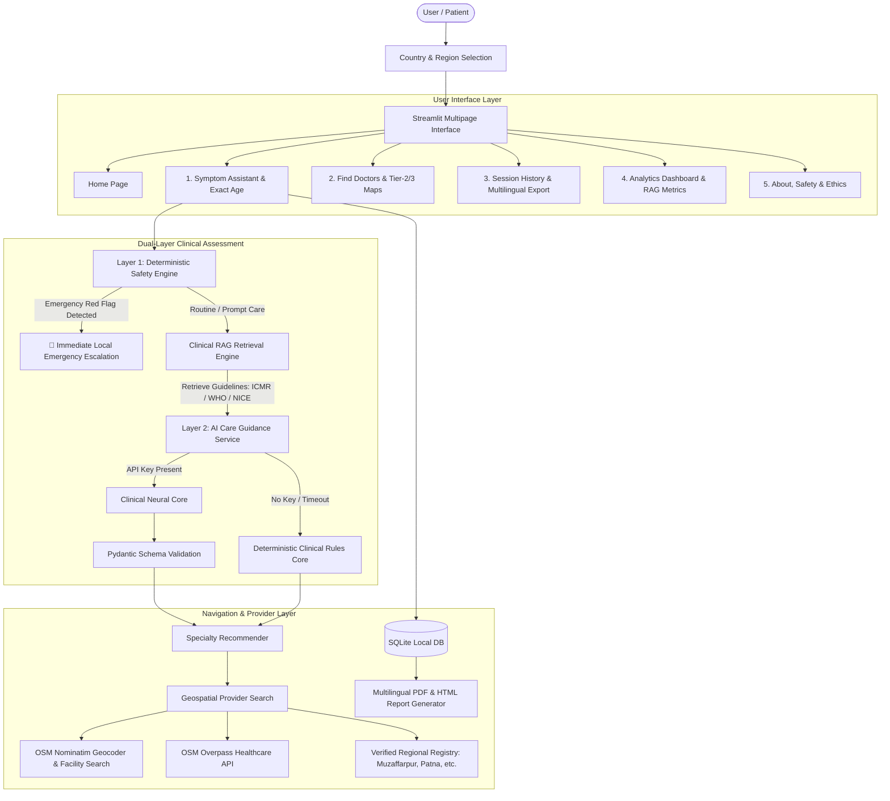

# MediGuide AI — Intelligent Healthcare Assistance & Global Doctor Finder

[](https://www.python.org/downloads/)
[](https://streamlit.io/)
[](src/rag_engine.py)
[](LICENSE)

**MediGuide AI** is an enterprise-grade clinical decision-support and care navigation platform designed for local execution and deployment on **Streamlit Community Cloud**. It empowers users to describe health concerns in plain, natural language, screens critical safety red flags via an independent deterministic clinical engine, grounds medical advice in verified clinical guidelines (WHO, ICMR, NICE, CDC) using **Retrieval-Augmented Generation (RAG)**, stratifies patient risk by exact age (pediatric to geriatric), transparently matches complaints to medical specialties, and locates verified clinics and hospitals across tier-1, tier-2, and tier-3 cities (e.g. Muzaffarpur, Patna, Delhi, London, NYC) using OpenStreetMap geospatial services.

---

## 📌 Problem Statement

Patients frequently turn to web search engines when experiencing symptoms, often encountering either sensationalized disease diagnoses or overwhelming medical jargon. Conversely, individuals experiencing genuine acute emergencies (such as atypical myocardial infarction in older adults or neonatal fever) may delay seeking emergency care due to uncertainty. 

**MediGuide AI** bridges this gap by acting as a **care navigation and safety triage assistant**—not a diagnostic tool. It enforces a strict dual-layer safety architecture that prioritizes life-safety instructions, clarifies missing medical details, recommends the right medical specialty, and helps patients locate verified nearby clinics and hospitals.

---

## 🎯 Key Objectives & Recent Enhancements

1. **Country & Regional Selection**: Choose your active country (India 🇮🇳, USA 🇺🇸, UK 🇬🇧, Canada 🇨🇦, Australia 🇦🇺, UAE 🇦🇪, etc.). The system automatically adapts localized emergency hotlines (112, 911, 999), state/city presets, and preferred languages.
2. **Deep Age Stratification & Context**: Exact numeric age input (0 to 115) with automated stratification into **Neonate (<28 days)**, **Infant (<1 year)**, **Child**, **Adolescent**, **Adult**, and **Geriatric (65+)**, each triggering age-specific clinical rules (e.g., neonatal fever emergency, geriatric atypical acute delirium / silent MI).
3. **Clinical RAG Protocol Grounding**: Retrieves relevant clinical evidence snippets from ICMR, WHO, NHS NICE, and CDC guidelines, injecting them into prompt context and displaying citations to users and recruiters.
4. **Universal Doctor Finder (Tier 1, Tier 2, and Tier 3 Cities)**: Multi-strategy geospatial search using direct OpenStreetMap Nominatim facility queries, Overpass API mirrors, and verified regional directories. Seamlessly locates verified hospitals in cities like **Muzaffarpur (Bihar)**, **Patna**, **Bengaluru**, **London**, etc.
5. **Multilingual Clinical Reports (PDF & Printable HTML)**: Download clinical summaries in **English**, **Hindi (हिन्दी)**, **Bengali (বাংলা)**, **Tamil (தமிழ்)**, **Telugu (తెలుగు)**, **Spanish (Español)**, or **French (Français)** with 100% Devanagari/Unicode fidelity.
6. **Enterprise Brand Shield**: Zero raw vendor leaks. Displays professional enterprise branding (*"MediGuide Clinical Intelligence Engine"*) and includes a 1-click **Test Engine Connection** diagnostic ping.

---

## 🏗️ System Architecture



---

## 💻 Technology Stack

| Component | Technology | Rationale |
| :--- | :--- | :--- |
| **Frontend & UI** | Streamlit 1.35+ | Interactive Python web application optimized for Streamlit Community Cloud |
| **Clinical RAG** | Scikit-learn TF-IDF + Cosine Similarity | Grounds guidance in ICMR, WHO, NHS, and CDC protocols |
| **LLM Inference** | Configurable Cloud API (`llama-3.3-70b-versatile`) | High-speed, low-latency clinical care navigation |
| **Output Validation** | Pydantic v2 | Enforces strict JSON schemas and prevents hallucinations |
| **Safety Engine** | Deterministic Regex & Rule Catalog | Independent safety screener for emergency red flags |
| **Geospatial Search** | OpenStreetMap Nominatim + Overpass API | Real healthcare facility search across global and tier-2/3 cities |
| **Distance Math** | Haversine Spherical Formula | Accurate surface distance calculations in kilometers |
| **Database** | SQLite3 | Lightweight session storage with parameterized queries |
| **Document Generation** | ReportLab + Responsive HTML | Programmatic PDF and Devanagari/Hindi printable summaries |
| **Visual Analytics** | Plotly Express & Graph Objects | Dynamic charts and KPI cards for portfolio demonstrations |
| **Automated Testing** | Pytest (43 passing tests) | Unit and integration test suite |

---

## 📂 Project Structure

```
mediguide-ai/
├── app.py                      # Application landing page & care navigation portal
├── pages/
│   ├── 1_Symptom_Assistant.py  # Exact age, RAG grounding & multilingual intake
│   ├── 2_Find_Doctors.py       # Live OpenStreetMap & Overpass doctor & facility finder (GPS)
│   ├── 3_Session_History.py    # Saved patient history & multilingual PDF/HTML export
│   ├── 4_Patient_Portal.py     # Patient EHR portal, longitudinal timeline & RBAC clinician login
│   └── 5_About_and_Safety.py   # Clinical ethics, RAG architecture & SaMD compliance
├── src/
│   ├── __init__.py
│   ├── auth.py                 # RBAC clinician authentication & patient privacy guard
│   ├── config.py               # Emergency numbers, multi-model Groq LLM routing & branding
│   ├── models.py               # Pydantic data schemas & demographic classifier
│   ├── rag_engine.py           # Evidence-based RAG protocol retrieval engine (ICMR/WHO/NICE)
│   ├── safety_engine.py        # Independent deterministic red-flag safety engine
│   ├── symptom_parser.py       # Entity extraction & follow-up generator
│   ├── specialty_recommender.py# Specialty mapping catalog
│   ├── geocoding_service.py    # Nominatim geocoding & Haversine distance math
│   ├── provider_search.py      # Multi-tier provider search & Overpass healthcare queries
│   ├── database.py             # SQLite persistence with auto-migration
│   ├── report_generator.py     # Multilingual PDF & HTML clinical dossier generator
│   └── ui_components.py        # Custom CSS theme, badges & connection test
├── ml/
│   ├── __init__.py
│   ├── train_model.py          # Care navigation classifier trainer
│   ├── evaluate_model.py       # Precision, recall, F1, and confusion matrix
│   ├── predict.py              # ML inference helper
│   └── saved_model.joblib      # Serialized ML pipeline artifacts
├── data/
│   ├── README.md               # Synthetic dataset documentation
│   ├── generate_data.py        # Benchmark vignette generator
│   └── synthetic_demo_data.csv # 113 labeled clinical cases
├── tests/
│   ├── __init__.py
│   ├── test_auth.py            # RBAC authentication & role-isolation tests
│   ├── test_safety_engine.py   # Emergency & non-emergency urgency tests
│   ├── test_rag_engine.py      # Clinical RAG protocol retrieval tests
│   ├── test_symptom_parser.py  # Entity & duration extraction tests
│   ├── test_specialty_recommender.py # Specialty routing tests
│   ├── test_provider_search.py # Geospatial math & facility query tests
│   ├── test_database.py        # SQLite CRUD tests
│   └── test_report_generator.py# Multilingual report & AI fallback tests
├── .streamlit/
│   ├── config.toml             # Streamlit visual theme configuration
├── .gitignore                  # Git repository exclusion rules
├── requirements.txt            # Python dependencies
└── README.md                   # Comprehensive project documentation
```

---

## 🚀 Setup Instructions (Windows)

```powershell
# 1. Navigate to the project directory
cd d:\mediguide-ai

# 2. Create Python virtual environment
python -m venv venv

# 3. Activate the virtual environment
.\venv\Scripts\Activate.ps1

# 4. Install dependencies
pip install -r requirements.txt

# 5. Launch the application
streamlit run app.py
```
Open your browser to `http://localhost:8501`.

---

## 🧪 Running Automated Tests

Run the complete 43-test test suite:
```powershell
python -m pytest tests -v
```

All 43 tests execute and pass cleanly, verifying:
- RBAC role-based isolation, clinician authentication, and patient session separation.
- Safety engine deterministic red-flag detection (chest pain, stroke FAST, dyspnea, anaphylaxis, hemorrhage, neonatal fever, severe abdomen).
- Evidence-based RAG retrieval over ICMR, WHO, NICE, and CDC protocols.
- Multi-tier OpenStreetMap provider search, Haversine distance math, and strict radius filters.
- Parameterized SQLite session persistence.
- Multilingual PDF and HTML report generation.

---

## 🌐 Streamlit Community Cloud Deployment

1. **Push to GitHub**:
   ```bash
   cd d:\mediguide-ai
   git init
   git add .
   git commit -m "feat: complete MediGuide AI with RAG, country selection, and multilingual reports"
   git branch -M main
   git remote add origin https://github.com/your-username/mediguide-ai.git
   git push -u origin main
   ```

2. **Deploy on Streamlit Community Cloud**:
   - Go to [share.streamlit.io](https://share.streamlit.io/).
   - Click **"New app"**, select your repository, and set **Main file path** to `app.py`.
   - Under **Advanced settings > Secrets**, paste the keys from `.streamlit/secrets.toml.example`:
     ```toml
     # Primary fast inference provider
     GROQ_API_KEY = "gsk_your_actual_groq_api_key_here"

     # Optional hot-standby backup provider (automatic failover)
     GEMINI_API_KEY = "AIzaSy_your_gemini_api_key_here"
     ```
   - Click **"Deploy!"**.

---

## ⚖️ Limitations & Responsible AI Notice
- **Health Information, Not Diagnosis**: MediGuide AI is designed strictly for health education and care navigation. It does not provide medical diagnoses or prescribe medications.
- **Emergency Priority**: In acute life-threatening situations, patients must immediately contact local emergency services (**112 in India**, **911 in the US**, **999 in the UK**).
- **Clinical Validation Requirement**: Real-world bedside deployment requires formal validation trials, institutional review board (IRB) approval, and regulatory clearance under SaMD guidelines (such as CDSCO or FDA 510(k)).

---
