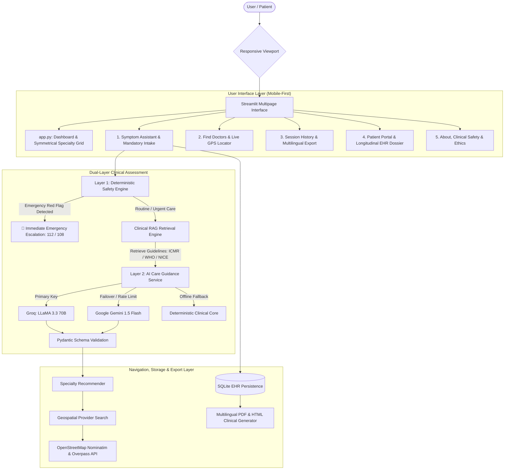

# MediGuide AI — Intelligent Clinical Triage & Care Navigation Platform

[](https://www.python.org/downloads/)
[](https://streamlit.io/)
[](src/rag_engine.py)
[](src/ai_service.py)
[](src/ui_components.py)
[](tests/)
[](LICENSE)

**MediGuide AI** is an enterprise-grade clinical decision-support and care navigation platform built for seamless deployment on **Streamlit Community Cloud** and local execution. It empowers patients to articulate medical concerns in plain, natural conversational language, screens critical emergency red flags through an independent deterministic clinical engine, grounds recommendations in verified clinical protocols (**ICMR, WHO, NICE, CDC**) via **Retrieval-Augmented Generation (RAG)**, automatically persists consultation records into a private longitudinal Electronic Health Record (EHR) database, and navigates patients to verified nearby medical specialists and hospitals across metro and tier-2/3 cities using live OpenStreetMap geospatial services.

---

## 📌 Problem Statement

When experiencing acute or confusing symptoms, patients frequently turn to commercial search engines—often encountering either catastrophic disease diagnoses or dense clinical jargon. Conversely, individuals experiencing genuine medical emergencies (such as atypical myocardial infarction in older adults or neonatal fever in infants) often delay seeking urgent care due to uncertainty.

**MediGuide AI** solves this critical gap by acting as a **care navigation and safety triage assistant**—not a diagnostic tool. It enforces a strict dual-layer safety architecture that prioritizes life safety, clarifies missing clinical information, recommends the correct medical specialty, and directs patients to verified local clinics and hospitals.

---

## 🌟 Key Features & Capabilities

1. 📱 **Mobile-First Responsive Clinical UI**:
   - Seamlessly responsive across smartphones (iOS Safari, Android Chrome), tablets, and widescreen desktop monitors.
   - Symmetrical 4&times;2 specialty capsule matrix on desktop that gracefully auto-reflows into touch-friendly single-column cards on mobile viewports with zero horizontal overflow.

2. 🛡️ **Dual-Layer Clinical Assessment**:
   - **Layer 1 (Deterministic Safety Engine)**: Independent regex rule catalog screening emergency red flags (acute chest pain, stroke FAST, respiratory distress, neonatal fever `< 28 days`, anaphylaxis, uncontrolled hemorrhage) *before* any LLM invocation.
   - **Layer 2 (Neural Care Guidance Core)**: High-speed clinical synthesis and doctor consultation preparation.

3. ⚡ **Multi-Provider Neural Failover (Hot Standby)**:
   - **Primary Engine**: Ultra-low-latency Groq Cloud (`llama-3.3-70b-versatile`).
   - **Secondary Engine**: Google Gemini (`gemini-1.5-flash`) via direct REST API with JSON schema enforcement.
   - **Tertiary Engine**: Deterministic offline clinical rules core.

4. 📚 **Evidence-Based RAG Protocol Grounding**:
   - Ingests and indexes verified clinical practice guidelines from the **Indian Council of Medical Research (ICMR)**, **World Health Organization (WHO)**, and **UK NICE**.
   - Explicitly cites reference authorities and guideline protocols in every generated patient report.

5. 🗂️ **Private Longitudinal Patient EHR & RBAC**:
   - Mandatory patient intake validation (Full Name, Patient ID, Age, Gender, Blood Group).
   - Consultations are **automatically persisted** to an SQLite database.
   - Patients access their personal health records by unique Patient ID (`MG-2026-XXXX`).
   - Hospital clinicians unlock the master patient registry via secure passkey authentication.

6. 📍 **Universal Healthcare Provider Locator (Live GPS & Tier-1/2/3 Cities)**:
   - Multi-strategy geospatial care discovery powered by OpenStreetMap Nominatim and Overpass API.
   - Strict clinical specialty taxonomy matching (Cardiology, Ophthalmology, ENT, Pulmonology, Orthopedics, Pediatrics, Dentistry, Internal Medicine).
   - Real facility discovery across global metros and Indian tier-2/3 cities (e.g. Muzaffarpur, Patna, Bengaluru, Delhi, Lucknow, Kolkata).

7. 🌐 **Multilingual Doctor-Ready Clinical Dossiers**:
   - Export structured clinical summaries in **English**, **Hindi (हिन्दी)**, **Bengali (বাংলা)**, **Tamil (தமிழ்)**, **Telugu (తెలుగు)**, **Spanish (Español)**, or **French (Français)**.
   - Available in both downloadable PDF dossiers (ReportLab) and 100% Devanagari/Unicode-compliant printable HTML format.

---

## 🏗️ System Architecture



---

## 💻 Technology Stack

| Component | Technology | Rationale |
| :--- | :--- | :--- |
| **Frontend & UI** | Streamlit 1.35+ & Responsive CSS3 | Multi-page clinical application with automatic mobile viewport reflow |
| **Clinical RAG Engine** | Scikit-learn TF-IDF + Cosine Similarity | Real-time guideline matching against ICMR, WHO, and NICE protocols |
| **Primary LLM** | Groq Cloud (`llama-3.3-70b-versatile`) | Sub-second inference latency for real-time symptom articulation |
| **Backup LLM** | Google Gemini (`gemini-1.5-flash`) | Automatic hot-standby failover via structured JSON REST endpoint |
| **Data Validation** | Pydantic v2 | Guarantees strict JSON schema conformance and eliminates hallucinated fields |
| **Safety Screener** | Deterministic Regex Rule Catalog | High-speed, independent emergency red-flag screening |
| **Geospatial Mapping** | OpenStreetMap Nominatim + Overpass API | Verified hospital and specialty clinic discovery with Haversine distance math |
| **Data Persistence** | SQLite3 | Parameterized, migration-resilient consultation storage |
| **Report Generation** | ReportLab + Responsive HTML5 | High-fidelity Devanagari/Hindi printable clinical summaries and PDF dossiers |
| **Test Suite** | Pytest (43 Passing Tests) | Comprehensive automated test coverage across all modules |

---

## 📂 Project Directory Structure

```
mediguide-ai/
├── app.py                      # Main landing page & care navigation portal
├── pages/
│   ├── 1_Symptom_Assistant.py  # Patient intake, RAG assessment & auto-EHR save
│   ├── 2_Find_Doctors.py       # Live OpenStreetMap & Overpass hospital locator (GPS)
│   ├── 3_Session_History.py    # Consultation history & multilingual export
│   ├── 4_Patient_Portal.py     # Longitudinal EHR dossier & RBAC clinician login
│   └── 5_About_and_Safety.py   # Clinical ethics, RAG architecture & SaMD compliance
├── src/
│   ├── __init__.py
│   ├── ai_service.py           # Multi-provider neural engine (Groq -> Gemini -> Fallback)
│   ├── auth.py                 # RBAC clinician authentication & patient privacy guard
│   ├── config.py               # Emergency numbers, multi-provider API keys & branding
│   ├── database.py             # SQLite persistence with auto-migration
│   ├── geocoding_service.py    # Nominatim geocoding & Haversine distance calculation
│   ├── models.py               # Pydantic data schemas & demographic classifier
│   ├── provider_search.py      # Multi-tier provider search & Overpass healthcare queries
│   ├── rag_engine.py           # Evidence-based RAG protocol retrieval engine
│   ├── report_generator.py     # Multilingual PDF & HTML clinical dossier generator
│   ├── safety_engine.py        # Independent deterministic red-flag safety engine
│   ├── specialty_recommender.py# Specialty mapping catalog
│   ├── symptom_parser.py       # Entity extraction & follow-up generator
│   └── ui_components.py        # Responsive CSS theme, mobile media queries & badges
├── ml/
│   ├── train_model.py          # Care navigation classifier trainer
│   ├── evaluate_model.py       # Precision, recall, F1 evaluation
│   ├── predict.py              # ML inference helper
│   └── saved_model.joblib      # Serialized ML pipeline artifacts
├── data/
│   ├── generate_data.py        # Benchmark clinical vignette generator
│   └── synthetic_demo_data.csv # 113 labeled clinical cases
├── tests/
│   ├── test_auth.py            # RBAC authentication & role-isolation tests
│   ├── test_database.py        # SQLite CRUD & auto-save tests
│   ├── test_provider_search.py # Geospatial math & facility query tests
│   ├── test_rag_engine.py      # Clinical RAG protocol retrieval tests
│   ├── test_report_generator.py# Multilingual report & AI fallback tests
│   ├── test_safety_engine.py   # Emergency & non-emergency urgency tests
│   ├── test_specialty_recommender.py # Specialty routing tests
│   └── test_symptom_parser.py  # Entity & duration extraction tests
├── .streamlit/
│   ├── config.toml             # Streamlit visual theme configuration
│   └── secrets.toml.example    # Template for Streamlit Cloud secrets manager
├── .env.example                # Template for local environment variables
├── .gitignore                  # Git exclusion rules (protects API keys & database)
├── LICENSE                     # MIT License
├── README.md                   # Comprehensive project documentation
└── requirements.txt            # Python dependencies
```

---

## 🚀 Local Setup & Installation

### 1. Clone the Repository
```bash
git clone https://github.com/Shariqueperwez/mediguide-ai.git
cd mediguide-ai
```

### 2. Create and Activate Virtual Environment
```powershell
# Windows PowerShell
python -m venv venv
.\venv\Scripts\Activate.ps1
```

### 3. Install Dependencies
```powershell
pip install -r requirements.txt
```

### 4. Configure Environment Secrets
Create a `.env` file in the project root (or `.streamlit/secrets.toml`):
```toml
# Primary fast inference provider (Free at https://console.groq.com/keys)
GROQ_API_KEY="gsk_your_groq_api_key_here"

# Optional secondary backup provider (Free at https://aistudio.google.com/app/apikey)
GEMINI_API_KEY="AIzaSy_your_gemini_api_key_here"
```

### 5. Launch the Application
```powershell
streamlit run app.py
```
Open your browser to `http://localhost:8501`.

---

## 🧪 Automated Testing

Run the full automated test suite:
```powershell
python -m pytest tests -v
```

**All 43 tests pass cleanly**, validating:
- Role-based clinician authentication and patient session privacy.
- Deterministic emergency red-flag detection (chest pain, stroke FAST, dyspnea, anaphylaxis, hemorrhage, neonatal fever).
- Evidence-based RAG retrieval over ICMR, WHO, and NICE clinical guidelines.
- Multi-tier OpenStreetMap provider search, Haversine distance math, and strict radius filters.
- Automatic SQLite session persistence and EHR dossier retrieval.
- Multilingual PDF and Devanagari/Hindi HTML report generation.

---

## ☁️ Deploying on Streamlit Community Cloud

1. Push your repository to GitHub: `https://github.com/Shariqueperwez/mediguide-ai`
2. Navigate to [share.streamlit.io](https://share.streamlit.io/) and log in with your GitHub account.
3. Click **"New app"**, select your repository, branch `main`, and main file path `app.py`.
4. Click **Advanced settings > Secrets**, and paste your API keys:
   ```toml
   GROQ_API_KEY = "gsk_your_groq_api_key_here"

   # Optional hot-standby failover
   GEMINI_API_KEY = "AIzaSy_your_gemini_api_key_here"
   ```
5. Click **Deploy!** Your app will be live with full SSL in seconds.

---

## ⚖️ Responsible AI & Clinical Disclaimer

- **Care Navigation, Not Diagnosis**: MediGuide AI is designed strictly for health education, symptom articulation, and care navigation. It does not establish definitive medical diagnoses or prescribe medications.
- **Emergency Situations**: In acute life-threatening situations, patients must immediately contact emergency medical services (**112 / 108 in India**, **911 in the US**, **999 in the UK**).
- **Clinical Governance**: Any hospital deployment requires formal institutional review board (IRB) approval, clinical validation trials, and SaMD regulatory clearance (CDSCO / FDA).

---

## 📄 License

This project is licensed under the [MIT License](LICENSE) — see the LICENSE file for details.
